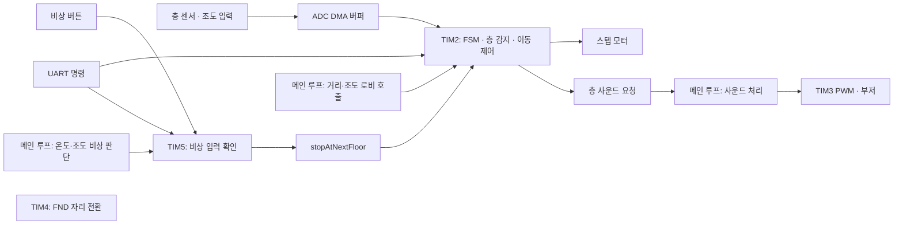

# STM32 엘리베이터 제어 시스템

NUCLEO-F411RE와 STM32 HAL을 사용한 3층 엘리베이터 모형 제어 프로젝트입니다. 층 버튼·UART 명령과 센서 입력에 따라 이동하며, 이동 중 비상이 감지되면 이동 방향을 유지한 채 다음 감지 층에서 정지하도록 구현했습니다.

핵심은 **타이머 인터럽트 기반 이동 제어**, **비상 입력 확인과 메인 루프 처리의 분리**, **층 센서 기반 상태 갱신**입니다.

## 시연

- [전체 동작 영상](https://drive.google.com/file/d/1EE3fmTnKbiAE042-x2fC5OMQD9OuJrPx/view)
- [비상 처리 영상](https://drive.google.com/file/d/13oAqV4IlNijQL13RI33TjWsxp0VWVCnp/view)
- [UART 1층 → 3층 영상](https://drive.google.com/file/d/1yS5ObFpkTDXuxGA_ZArS5HB3Yzja3XVP/view)
- [UART 3층 → 2층 영상](https://drive.google.com/file/d/1XWFjfef61wtSbKiE_9OcrOv1D8Ed3XYd/view)


## 개발 환경과 담당 역할

| 항목 | 내용 |
| --- | --- |
| 보드 / MCU | NUCLEO-F411RE / STM32F411RE |
| 언어 / 라이브러리 | C / STM32 HAL |
| 개발 도구 | STM32CubeIDE, STM32CubeMX 설정 파일 포함 |
| 실행 구조 | 메인 루프 + 타이머·UART·외부 인터럽트 |
| 기준 소스 | `20261109_elevatorFinal.zip` |

발표자료에 기재된 역할 분담입니다. HAL/CMSIS 및 공용 드라이버 전체를 개인 단독 작성 코드로 주장하지 않습니다.

| 담당자 | 담당 범위 |
| --- | --- |
| **본인** | 엘리베이터 제어, 로비 호출, 비상 처리, 모터, LCD/FND, RTC, 사운드 |
| 팀원 | UART 통신, GUI 개발, DHT11 센서 연결 |

UART는 팀원 구현과 제어부가 연동되는 기능입니다. PC GUI 소스는 현재 제공된 펌웨어 패키지에 포함되어 있지 않습니다.

## 시스템 아키텍처



| 실행 위치 | 설정 주기 | 역할 |
| --- | --- | --- |
| TIM2 인터럽트 | 2ms | 상태 전환, 층 센서 확인, 모터 스텝 출력 |
| TIM5 인터럽트 | 1ms | 비상 버튼 디바운스, 저장된 비상 정보 조합, 정지 예약 |
| TIM4 인터럽트 | 1ms | FND 자리 전환 |
| TIM3 | 가변 PWM | 부저 음 출력 |
| 메인 루프 | 기능별 경과 시간 확인 | 일반 층 버튼, 로비, DHT, LCD/RTC, 사운드, 온습도 응답 |

주기는 타이머 설정값이며 ISR 실행 시간이나 최악 응답 시간을 측정한 수치가 아닙니다. DHT 기반 비상 조건은 메인 루프에서 2초 간격으로 확인합니다. UART의 일부 응답 송신은 수신 콜백에서 실행됩니다.

## 핵심 구현

### 1. 상태와 이동 방향을 분리한 층 이동

`STOP`, `MOVING`, `EMERGENCY` 상태를 사용합니다. 이동 시작 시 방향을 저장하고, 이동 방향에 있는 층 센서의 ADC 값이 1800을 초과하면 현재 층을 갱신합니다. 목표 층 도착 또는 비상 정지 예약 시 모터 스텝 출력을 중단합니다.

관련 코드: [elevator.c](firmware/Core/Src/ap/service/elevator/elevator.c)의 `elevator_timerISR()`, `floor_detect()`.

### 2. 비상 입력 확인과 다음 층 정지

TIM5에서 비상 버튼을 읽어 동일 입력이 5회 연속 관찰되면 안정 상태로 반영합니다. 버튼을 눌렀다 놓는 전이에서 수동 비상 상태를 토글합니다. 수동 버튼·환경 조건·UART 비상 명령을 OR로 조합하고, 이동 중 비상 상태이면 `stopAtNextFloor`를 설정합니다.

TIM2는 다음 층 센서 감지 시 `EMERGENCY`로 전환합니다. 정지 예약은 이동 중 비상 입력이 해제되더라도 다음 감지 층 정지까지 유지됩니다.

관련 코드: [elevator.c](firmware/Core/Src/ap/service/elevator/elevator.c)의 `elevator_emergencyISR()`.

### 3. 거리·조도 조건을 조합한 로비 호출

HC-SR04의 유효한 측정값이 `0 < 거리 ≤ 50cm`일 때 조도 입력을 확인합니다. ADC 2700 이상에서 차단 상태로, 1200 이하에서 해제 상태로 변경해 두 임계값 사이에서는 이전 상태를 유지합니다. 접근·차단 조건이 충족되면 1층 복귀를 요청하며, 호출 플래그로 중복 요청을 제한합니다. 유효한 거리값이 50cm를 초과하면 재호출이 가능해집니다.

관련 코드: [lobby.c](firmware/Core/Src/ap/service/lobby/lobby.c)의 `lobby_task()`, `lobby_isBlocked()`.

### 4. ISR과 메인 루프 사이의 사운드 요청 전달

층 감지는 ISR에서 처리하되, 재생 요청만 `pendingFloorSound`에 저장합니다. 메인 루프는 기존 PRIMASK를 저장한 짧은 임계 구역에서 요청을 가져오고 초기화한 뒤 원래 인터럽트 상태를 복원합니다. 실제 재생은 `sound_task()`가 150ms 경과 여부와 재생 단계를 이용해 진행합니다.

시작음 `sound_power()`는 `HAL_Delay()`를 사용합니다. 따라서 전체 펌웨어를 완전한 비차단 구조로 표현하지 않습니다.

관련 코드: [elevator.c](firmware/Core/Src/ap/service/elevator/elevator.c), [sound.c](firmware/Core/Src/ap/service/sound/sound.c).

## 트러블슈팅

| 문제 | 변경 내용 | 확인 근거 |
| --- | --- | --- |
| 메인 루프의 통신·대기로 비상 입력 확인 간격이 영향을 받음 | TIM5 입력 확인과 TIM2 이동 제어 분리 | 이전 ZIP·최종 ZIP의 콜백 및 호출 위치 비교 |
| 2층 통과 플래그와 층 차이에 의존한 비상 목표 층 처리 | 이동 방향·현재 층 갱신·다음 층 정지 예약 도입 | `floor_detect()`와 `stopAtNextFloor` 비교 |
| 지연 함수를 사용하는 버튼 처리를 ISR에 그대로 옮길 수 없음 | 비상 버튼 전용 연속 샘플 디바운스 구현 | 일반 버튼의 `HAL_Delay(5)`와 비상 ISR 비교 |

상세 과정과 검증 범위는 [트러블슈팅 문서](docs/troubleshooting.md)에 정리했습니다. 


## 저장소 구성

```text
firmware/
  Core/Src/ap/         애플리케이션 및 서비스
  Core/Src/driver/     주변장치 드라이버
  Core/Src/common/     공통 유틸리티
  Drivers/            HAL 및 CMSIS
  *.ioc, *.ld         MCU 설정과 링커 스크립트
docs/
  troubleshooting.md  이전 코드와 최종 코드 비교
  pinmap.md           핀 연결
  uart.md             UART 프레임과 명령
  verification.md     확인 범위와 후속 검증 항목
```

기존 소스와 프로젝트 설정은 그대로 보존하고, `Debug/` 빌드 산출물만 배포 구성에서 제외했습니다.

## 현재 한계

센서 미감지 시 이동 타임아웃과 자동 원점 탐색은 현재 이동 제어 코드에 없습니다. 타이머 설정 주기와 실제 응답 시간은 구분해야 하며, UART 수신 콜백의 블로킹 송신과 인터럽트 간 간섭은 추가 검증 대상입니다. 개선 아이디어는 구현 완료 기능과 구분해 [검증 문서](docs/verification.md)에 기록했습니다.

## 원본 자료

- [발표자료 및 시연 폴더](https://drive.google.com/drive/folders/1H0n3awHjNVqifJTDnzbBcO9EdWUltdXi)
- [최종 소스 ZIP](https://drive.google.com/file/d/1qcFF_7iWqdmMR6ymgr_pIdehZdnbrv-S/view)
