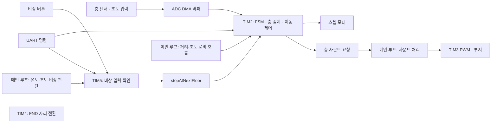

# 시스템 구조와 핵심 구현

## 전체 구조

| 실행 위치 | 설정 주기 | 역할 |
| --- | --- | --- |
| TIM2 인터럽트 | 2ms | 상태 전환, 층 센서 확인, 모터 스텝 출력 |
| TIM5 인터럽트 | 1ms | 비상 버튼 디바운스, 저장된 비상 정보 조합, 정지 예약 |
| TIM4 인터럽트 | 1ms | FND 자리 전환 |
| TIM3 | 가변 PWM | 부저 음 출력 |
| 메인 루프 | 기능별 경과 시간 확인 | 일반 층 버튼, 로비, DHT, LCD/RTC, 사운드, 온습도 응답 |

주기는 타이머 설정값이며 ISR 실행 시간이나 최악 응답 시간을 측정한 수치가 아닙니다. DHT 기반 비상 조건은 메인 루프에서 2초 간격으로 확인합니다. UART의 일부 응답 송신은 수신 콜백에서 실행됩니다.

## 핵심 구현

### 1. 상태와 이동 방향을 분리한 층 이동

`STOP`, `MOVING`, `EMERGENCY` 상태를 사용합니다. 이동 시작 시 방향을 저장하고, 이동 방향에 있는 층 센서의 ADC 값이 1800을 초과하면 현재 층을 갱신합니다. 목표 층 도착 또는 비상 정지 예약 시 모터 스텝 출력을 중단합니다.

관련 코드: [elevator.c](../firmware/Core/Src/ap/service/elevator/elevator.c)의 `elevator_timerISR()`, `floor_detect()`.

### 2. 비상 입력 확인과 다음 층 정지

TIM5에서 비상 버튼을 읽어 동일 입력이 5회 연속 관찰되면 안정 상태로 반영합니다. 버튼을 눌렀다 놓는 전이에서 수동 비상 상태를 토글합니다. 수동 버튼·환경 조건·UART 비상 명령을 OR로 조합하고, 이동 중 비상 상태이면 `stopAtNextFloor`를 설정합니다.

TIM2는 다음 층 센서 감지 시 `EMERGENCY`로 전환합니다. 정지 예약은 이동 중 비상 입력이 해제되더라도 다음 감지 층 정지까지 유지됩니다.

관련 코드: [elevator.c](../firmware/Core/Src/ap/service/elevator/elevator.c)의 `elevator_emergencyISR()`.

### 3. 거리·조도 조건을 조합한 로비 호출

HC-SR04의 유효한 측정값이 `0 < 거리 ≤ 50cm`일 때 조도 입력을 확인합니다. ADC 2700 이상에서 차단 상태로, 1200 이하에서 해제 상태로 변경해 두 임계값 사이에서는 이전 상태를 유지합니다. 접근·차단 조건이 충족되면 1층 복귀를 요청하며, 호출 플래그로 중복 요청을 제한합니다. 유효한 거리값이 50cm를 초과하면 재호출이 가능해집니다.

관련 코드: [lobby.c](../firmware/Core/Src/ap/service/lobby/lobby.c)의 `lobby_task()`, `lobby_isBlocked()`.

### 4. ISR과 메인 루프 사이의 사운드 요청 전달

층 감지는 ISR에서 처리하되, 재생 요청만 `pendingFloorSound`에 저장합니다. 메인 루프는 기존 PRIMASK를 저장한 짧은 임계 구역에서 요청을 가져오고 초기화한 뒤 원래 인터럽트 상태를 복원합니다. 실제 재생은 `sound_task()`가 150ms 경과 여부와 재생 단계를 이용해 진행합니다.

시작음 `sound_power()`는 `HAL_Delay()`를 사용합니다. 

관련 코드: [elevator.c](../firmware/Core/Src/ap/service/elevator/elevator.c), [sound.c](../firmware/Core/Src/ap/service/sound/sound.c).
